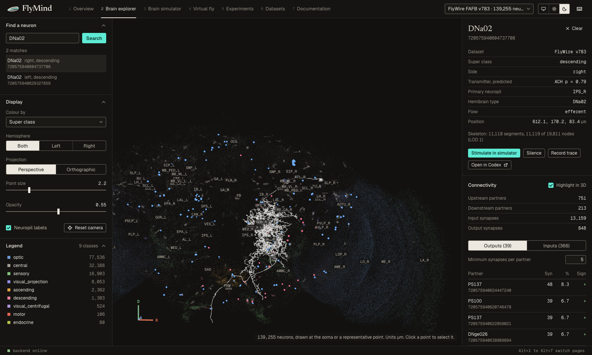
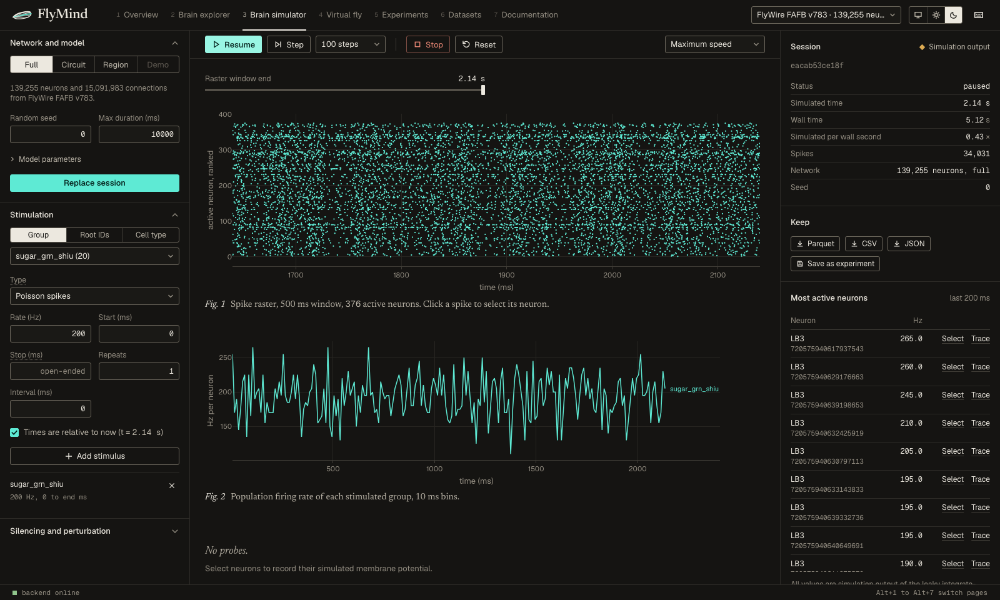
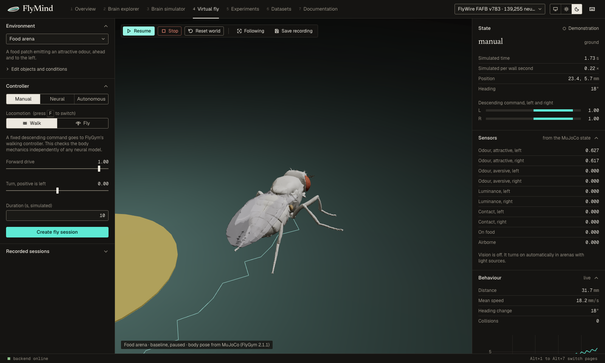
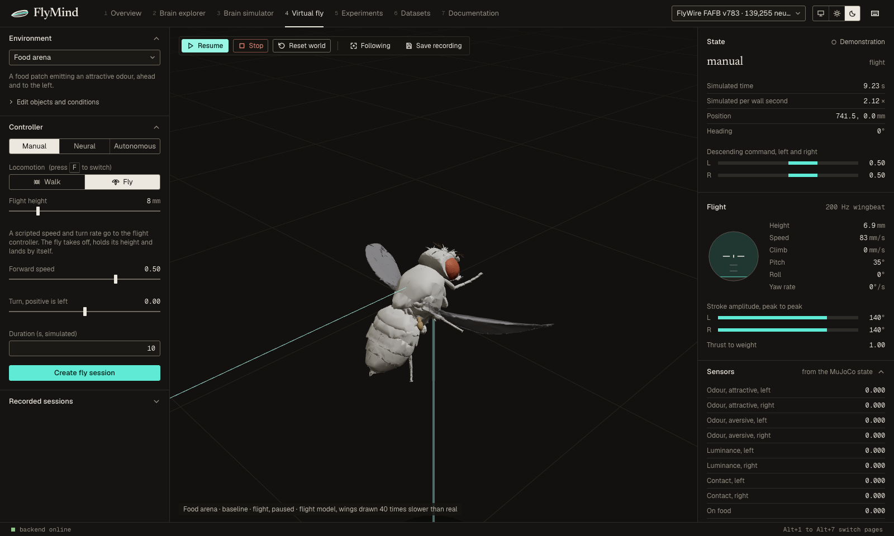

# FlyMind

**A virtual *Drosophila* laboratory: simulate the FlyWire connectome, embody it in a physics-based fly, and explore real neuronal anatomy in 3D, with the evidence for every claim kept visible.**



FlyMind connects three tools that share one dataset representation and one simulation core:

| | |
|---|---|
| **Brain Simulator** | Leaky integrate-and-fire dynamics on the real FlyWire FAFB v783 wiring diagram (139,255 neurons, 15.1 M connections, 54.5 M synapses), reimplementing the model of [Shiu et al. 2024](https://doi.org/10.1038/s41586-024-07763-9). Full-brain, region, circuit and demonstration modes; live stimulation, silencing and reversible lesions; raster, rates, traces and regional activity. |
| **Virtual Fly** | The official NeuroMechFly v2 body in MuJoCo (FlyGym 2.1.1). Its sensors feed the neural model, and descending-neuron activity drives a CPG walking controller through a documented interface that labels every non-connectome component. It can also fly: a reduced-order flight model (quasi-steady blade-element aerodynamics, 6-DoF body; a FlyMind model, see [flight model](docs/scientific/flight.md)) gives take-off, hover, saccadic flight and landing, and an autonomous demonstration policy strings walking, flight, odour tracking and feeding together. |
| **Brain Explorer 3D** | All proofread neurons in anatomical space, plus reconstructed skeletons with level-of-detail rendering. Includes search, input/output tables, pathway tracing, subgraph export and a simulated-activity overlay. |

> **What FlyMind is not.** A connectome is not a functional brain. Simulated activity is model output, not recorded activity. Walking is produced by FlyGym's controller, because the FAFB connectome contains no ventral nerve cord. FlyMind labels results as *published*, *reproduced*, *simulation output*, *hypothesis* or *demonstration*.

## Highlights (measured)

* **Reproduced a published result.** On the exact v630 network and neuron IDs of Shiu et al. 2024, sugar-GRN stimulation drives MN9 at **93.4 Hz** with 200 Hz input (reference 93.3 Hz) and at **67.6 Hz** with 100 Hz input (reference 67.0 Hz). Each is a mean of 30 trials; see the [evidence](docs/evidence/reproduction-shiu2024.md).
* **Spike-for-spike agreement with Brian2.** The reference simulator gives identical spike trains, with membrane potentials within 1e-9 mV (`tests/unit/test_brian2_equivalence.py`).
* **Full-brain speed on a laptop CPU.** FlyMind simulates the whole v783 brain at **0.45× real time** on an Apple M2 Max (one core, Numba) and renders all 139,255 neurons at the display's 120 fps ([benchmarks](docs/evidence/benchmarks.md)).
* **An honest closed loop.** On FlyWire v783, odour input to DM1 olfactory receptor neurons drives DNa02 but not P9. The neural-controlled fly therefore turns in place instead of approaching food, and FlyMind reports exactly that ([embodied runs](docs/evidence/embodied-flywire.md)).

| Brain Simulator: full brain, sugar GRNs | Virtual Fly: food arena | Virtual Fly: flight |
|---|---|---|
|  |  |  |

All screenshots are of the running application. They show FlyWire data (Dorkenwald et al. 2024; Schlegel et al. 2024), used with attribution.

## Quickstart

Requirements:

* macOS (Apple Silicon or Intel) or Linux
* [uv](https://docs.astral.sh/uv/)
* Node.js ≥ 20
* a C++ compiler (`xcode-select --install` / `build-essential`)

```bash
git clone https://github.com/Ale-Newport/FlyMind.git && cd FlyMind
make setup        # Python 3.13 + locked dependencies, web dependencies, synthetic dataset
make dev          # API http://127.0.0.1:8000  +  web app http://127.0.0.1:5173
```

A fresh clone runs entirely on a small, clearly labelled synthetic network. It needs no credentials and no downloads.

### Real data

```bash
make data-flywire     # FlyWire v783 from open sources (~150 MB, checksummed), imported and validated
make data-630         # optional: the Shiu et al. v630 network (reproduction)
make data-skeletons   # optional: 5.4 GB of neuron skeletons for the 3D explorer
make reproduce        # re-run the Shiu et al. reproduction (~2 min)
```

FlyWire Codex downloads require a sign-in, and FlyMind never automates that. Download the files yourself, then run `uv run flymind data import <folder>`; files are recognised by their headers. See [Importing FlyWire data](docs/tutorials/02-importing-flywire.md).

### Commands

| Command | What it does |
|---|---|
| `make dev` / `make explorer` | full application / open the Brain Explorer |
| `make brain` | headless brain simulation on the demo network |
| `make virtual-fly` | headless virtual-fly run |
| `uv run flymind sim run --dataset flywire_fafb_783 --group sugar_grn_shiu` | full-brain run from the CLI |
| `uv run flymind fly run --arena food --controller neural --dataset flywire_fafb_783` | closed loop from the CLI |
| `uv run flymind experiment templates` / `run <template> --dataset <id>` | reproducible experiments |
| `make test` · `make test-all` · `make test-fulldata` · `make test-web` · `make e2e` | tests |
| `make benchmark` · `make docs` · `make doctor` | benchmarks, documentation site, diagnostics |

### Example experiment

```bash
uv run flymind experiment run silencing --dataset flywire_fafb_783
```

This runs sugar-GRN stimulation, intact vs two GRNs silenced, for 10 trials each with common random numbers. It writes `experiments/<id>/` containing `spec.json`, `record.json` (dataset checksums, seeds, software versions, git commit, machine, timing, assumptions), spikes, rates, readouts and a README. You can re-run it from `spec.json` and compare with `flymind experiment compare`.

## Architecture

```
FlyWire releases ─► connectome/ (detect · adapt · validate · CSR + Parquet + manifest)
                        ├─► brain/ LIF engines (Numba · NumPy · Brian2 reference) ─► embodiment/ bridge ─► FlyGym/MuJoCo
                        ├─► visualization/ (points · skeleton LOD)
                        └─► experiments/ (specs · runner · provenance · comparison)
                                   api/ FastAPI (REST + WebSockets)  ─►  apps/web React · three.js · Plotly
```

```
src/flymind/{common,connectome,brain,visualization,embodiment,experiments,api}   Python package (layered, tested)
apps/web/                 React + TypeScript + React Three Fiber + Tailwind + Zustand + Plotly
tests/{unit,integration,fulldata}   pytest · apps/web/tests/{unit,e2e}  Vitest · Playwright
scripts/{setup,data,benchmarks,validation}   dev launcher, static demo export, benchmarks, plotting
docs/{scientific,architecture,tutorials,evidence,research,troubleshooting,api}
data/manifests/groups/    curated, cited neuron groups (IDs only; no FlyWire data is committed)
```

Details are in [Architecture overview](docs/architecture/overview.md) and the [decision records](docs/architecture/adr/).

## Hardware and performance

CPU only; no GPU is required. Measured on an Apple M2 Max (12 cores, 64 GB):

* **Full brain:** 1 simulated second takes 2.24 s.
* **Region mode** (antennal lobe + lateral horn, 4,433 neurons): 3.8× real time.
* **MuJoCo walking:** 0.26× real time.
* **Full-brain closed loop:** 0.14× real time.
* **Import:** v783 imports in 18 s.

**Memory:** about 4 GB peak during import, and about 1 GB per full-brain session. See [benchmarks](docs/evidence/benchmarks.md).

## Documentation

* **Scientific:** [neuron model](docs/scientific/neuron-model.md) · [connectome sources & licences](docs/scientific/connectome-sources.md) · [interventions](docs/scientific/interventions.md) · [neural–body interface](docs/scientific/neural-body-interface.md) · [validation](docs/scientific/validation.md) · [limitations](docs/scientific/limitations.md) · [references](docs/scientific/references.md)
* **Tutorials:** [installation](docs/tutorials/01-installation.md) → [extending](docs/tutorials/10-extending.md)
* **Evidence:** [feature matrix](docs/evidence/feature-matrix.md) · [test results](docs/evidence/test-results.md) · [implementation status](docs/IMPLEMENTATION_STATUS.md)
* **Research:** [reference repositories](docs/research/reference-repositories.md) · [troubleshooting](docs/troubleshooting/index.md) · [API](docs/api/index.md)

The public GitHub Pages site serves only a browser-side preview of the **synthetic** network plus the documentation. The brain simulation and MuJoCo physics need the local backend.

## Known limitations

These are the most important; see [Limitations](docs/scientific/limitations.md) for the full list.

* **Neurons:** point neurons with one shared parameter set.
* **Synapses:** synapse counts stand in for synaptic strength, and the sign comes from predicted transmitters.
* **Brain-wide physiology:** no neuromodulation, gap junctions, plasticity or spontaneous activity.
* **Body:** there is no ventral nerve cord, so leg coordination comes from FlyGym's CPG and rule controller.
* **Bridge:** the sensor encodings and descending-neuron readout are FlyMind assumptions.
* **Senses:** the odour field is analytic, vision is eye-averaged luminance, and FlyVis is not integrated (it requires Python < 3.13).
* **Datasets:** BANC and male-CNS adapters are planned and refuse imports until they are validated.
* **Browsers:** automated tests run in Chromium only.

## Citing and licences

FlyMind's code is MIT ([LICENSE](LICENSE)). The connectome data, skeletons and the NeuroMechFly model are used under their providers' terms, and FlyMind does not redistribute them ([THIRD_PARTY_NOTICES.md](THIRD_PARTY_NOTICES.md)). FlyWire states CC BY-NC 4.0 for its public release.

Please cite FlyMind ([CITATION.cff](CITATION.cff)) together with the works it builds on:

* Shiu et al. 2024 (*Nature* 634:210)
* Dorkenwald et al. 2024 (*Nature* 634:124)
* Schlegel et al. 2024 (*Nature* 634:139)
* Eckstein, Bates et al. 2024 (*Cell* 187)
* Wang-Chen et al. 2024 (*Nature Methods* 21)
