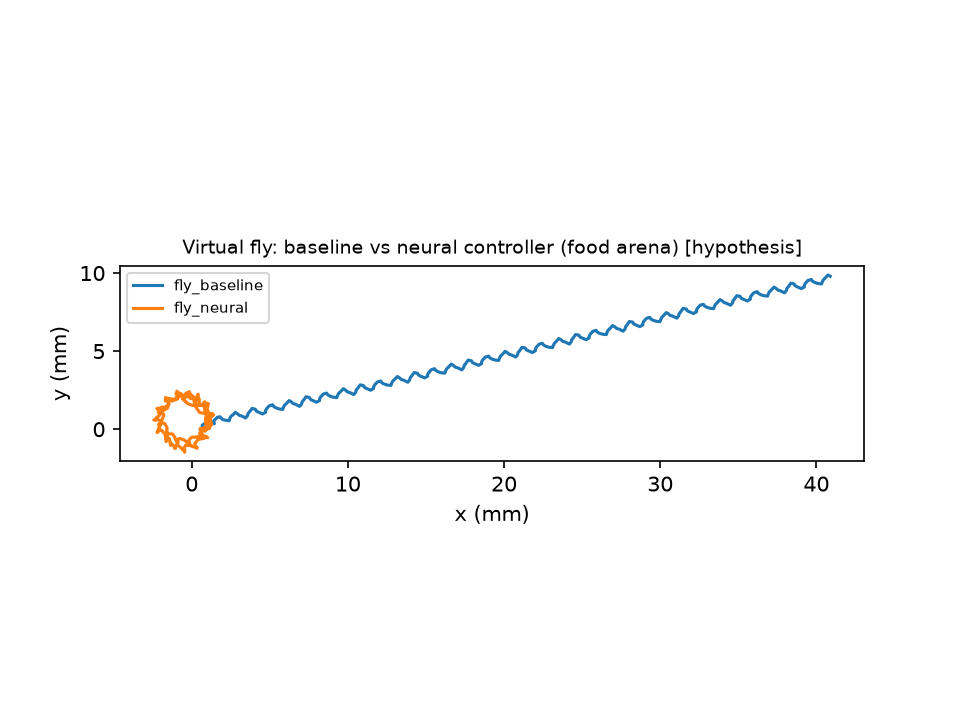

# Embodied runs on FlyWire v783

**Evidence category: hypothesis test (simulation output).** The question these runs ask
is whether the literature-based bridge (DM1 ORN input; P9, DNa02 and MDN readouts) makes
the FlyWire LIF model steer the NeuroMechFly body toward an attractive odour.

**Setup**

* **Arena:** food arena, with the odour source and food patch at (18, 8) mm. The fly
  starts at the origin, heading +x, with the source 19.2 mm away.
* **Duration:** 3 s simulated, seed 0.
* **Brain:** full brain, 139,255 neurons.
* **Bridge:** `flywire_literature` with no tonic drive.
* **Code:** commit `a4e2bcd`.

## Baseline vs neural controller (`embodied_flywire783_food_baseline_vs_neural`)

| Metric | Baseline (fixed command) | Neural (connectome-driven) |
|---|---|---|
| Distance travelled | 55.4 mm | 43.2 mm |
| Net displacement | 41.5 mm | 2.2 mm |
| Heading change | +13° | +860° |
| Closest approach to odour source | 3.5 mm (passed by) | 18.0 mm |
| Final distance to source | 23.0 mm | 19.5 mm |
| Mean readout rates | — | DNa02-L 52.9 Hz, DNa02-R 1.0 Hz, P9-L/R 0 Hz, MDN 0 Hz, MN9 0 Hz |

**Observation.** Bilateral DM1 input, about 0.8 a.u. on each antenna, drove DNa02-left
strongly but did not drive P9. The descending command was almost purely a turn, so the
fly walked in small circles near its start position.

**Interpretation, as a hypothesis.** In this model and with this readout mapping, DM1
input alone does not engage the forward-walking DN, and the odour gradient between the
antennae is too small to steer the fly toward the source. Odour-guided approach did
**not** emerge. Possible reasons:

* missing neuromodulatory or state inputs;
* the absence of a VNC;
* the readout or encoding choices;
* model parameters.

## Silencing DNa02-left (`embodied_flywire783_food_dna02l_silencing`)

| Metric | Intact | DNa02-left output blocked |
|---|---|---|
| Distance travelled | 43.2 mm | 0.2 mm |
| Heading change | +860° | +0.2° |
| Mean descending command | 0.65 | 0.00 |

Blocking DNa02-left's output also removes it from the motor readout, as a genetic
silencing of the DN would remove its effect on the VNC. With it blocked, no readout
neuron is active, so the fly stands still. This confirms that the circling in the intact
run was carried entirely by DNa02-left.

## Synthetic comparison (`embodied_fixture_food_baseline_vs_neural`, demonstration)

On the hand-wired synthetic network, the neural controller walked 18.7 mm with net
displacement 10.9 mm and a heading change of −100°. The cause is a structural
right-turn bias of the random synthetic wiring (DN_turn_R 16.5 Hz vs DN_turn_L 8.7 Hz).
This demonstrates the pipeline only.
