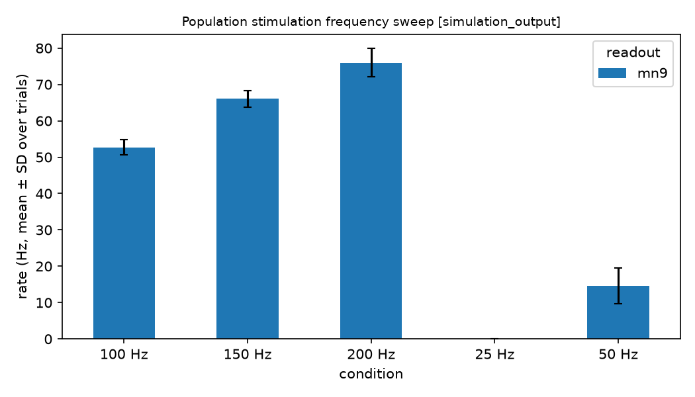
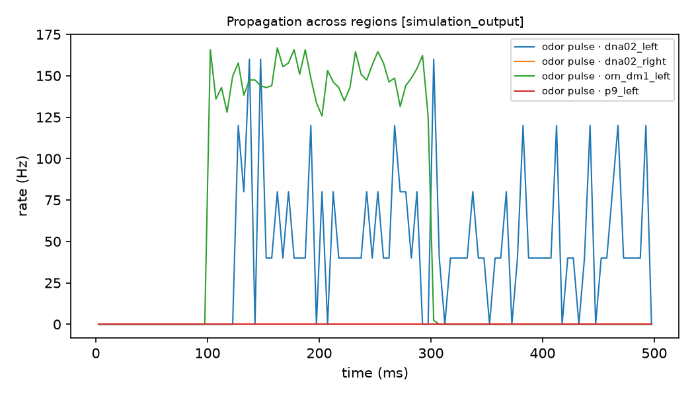

# FlyWire v783 experiments

**Evidence category: simulation output.** These are results of the LIF model on the
v783 connectome; they are not recorded neural activity. All runs used commit `a4e2bcd`.
Records are in [`experiments/`](experiments/) and figures in [`figures/`](figures/).

## Sugar-GRN frequency sweep → MN9 (`flywire783_sugar_frequency_sweep`)

Twenty sugar GRNs were Poisson-driven for 1 s per trial, 5 trials per rate. The readout
is the mean of the two MN9 neurons (CB0701 left and right).

| Drive | 25 Hz | 50 Hz | 100 Hz | 150 Hz | 200 Hz |
|---|---|---|---|---|---|
| MN9 (Hz, mean ± SD) | 0.0 ± 0.0 | 14.6 ± 5.0 | 52.7 ± 2.1 | 66.1 ± 2.3 | 76.0 ± 3.9 |

The response is monotonic with a threshold between 25 and 50 Hz, qualitatively like
Shiu et al. Fig. 1d (on v630). The v783 values are not directly comparable to the
published v630 numbers: the network differs, and this readout averages two MN9 neurons.

## Silencing two sugar GRNs (`flywire783_sugar_silencing`)

Sugar GRNs at 100 Hz, 10 trials, with and without blocking the output of
`720575940617937543` and `720575940621754367`. MN9 went from 53.7 ± 4.3 Hz (intact) to
52.0 ± 4.1 Hz (silenced). This is a small decrease, within about one SD, consistent with
removing 2 of 20 inputs.

## Olfactory propagation (`flywire783_dm1_propagation`)

Left DM1 ORNs were driven at 150 Hz from 100 to 300 ms (5 trials, 5 ms bins):

* **DNa02-left** became active at about 127 ms, roughly 25 ms after the ORNs, and peaked
  at 160 Hz.
* **DNa02-right and P9-left** stayed silent.
* The most active regions were LH_L (54.6 Hz mean per neuron), MB_ML_L, LH_R, MB_ML_R,
  AL_L and AL_R.

In this model, unilateral DM1 input reaches the lateral horn and mushroom body
bilaterally and drives the ipsilateral steering DN, but not the forward-walking DN P9.

